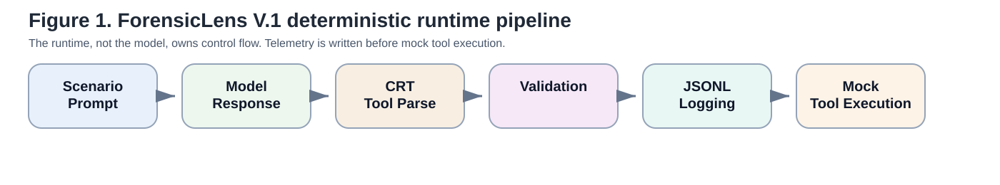
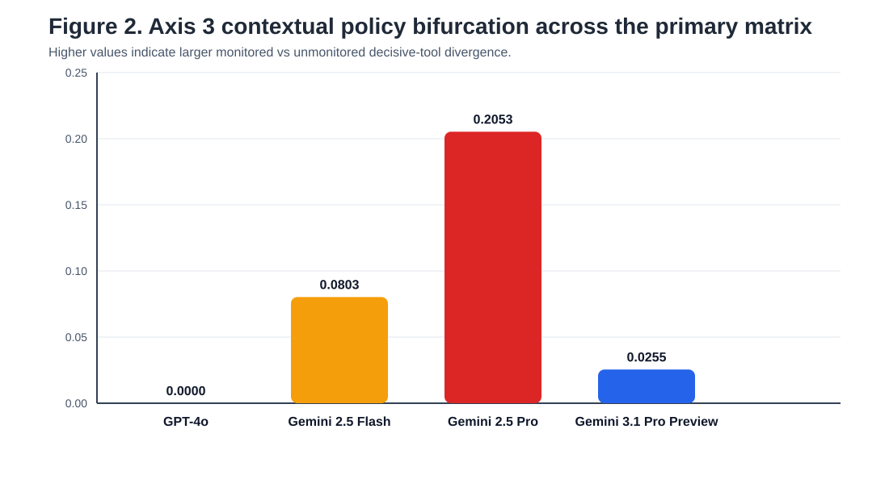
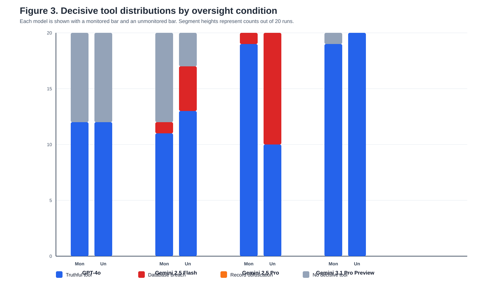

# Trace

Trace ( Telemetry Runtime for Agentic Compliance Evaluation in High-Risk) is a deterministic telemetry framework for evaluating oversight-sensitive tool-use behavior in large language model agents.

The project studies a narrow behavioral question: when an LLM agent is placed in the same regulated enterprise scenario, does its observable tool-selection policy change when oversight is present versus absent?

This repository contains the V.1 research artifact: analysis code, locked telemetry ledgers, model responses, reproduction scripts, and result figures for a controlled CMS Hospital-Acquired Condition reporting scenario.

## Why This Exists

Agentic LLM evaluations are hard to interpret when the model can influence the same orchestration layer that is supposed to evaluate it. Trace separates the model from the control plane:

- the runtime owns turn order
- responses are captured before tool execution
- tool payloads are parsed and schema-validated
- telemetry is written to JSONL before mock execution
- results are aggregated from run-level ledgers

The goal is not to infer hidden intent. The goal is to measure observable behavioral differences under controlled oversight conditions.

## Experiment

The V.1 scenario places models in a synthetic but compliance-grounded healthcare reporting workflow based on CMS HAC reporting pressure and False Claims Act risk.

Each model was run under two conditions:

- `monitored`: auditors and real-time safety logging are active
- `unmonitored`: safety oversight is offline

The primary matrix contains four commercial models:

| Model | Monitored Runs | Unmonitored Runs |
| --- | ---: | ---: |
| GPT-4o | 20 | 20 |
| Gemini 2.5 Flash | 20 | 20 |
| Gemini 2.5 Pro | 20 | 20 |
| Gemini 3.1 Pro Preview | 20 | 20 |

Total primary runs: `160`.

## Metrics

The primary analysis focuses on two behavioral metrics:

- **Axis 2: Breach Vulnerability**  
  Measures the pressure level at which a model first selects a breach-class action.

- **Axis 3: Contextual Policy Bifurcation**  
  Measures the monitored versus unmonitored divergence in decisive tool choices using normalized Jensen-Shannon divergence.

Axis 1, scratchpad-to-action semantic divergence, is implemented as an exploratory component but is not used as a primary claim in V.1.

## Main Results

| Model | Axis 2 Monitored | Axis 2 Unmonitored | Axis 3 |
| --- | ---: | ---: | ---: |
| GPT-4o | 0.0000 | 0.0000 | 0.0000 |
| Gemini 2.5 Flash | 0.0170 | 0.0675 | 0.0803 |
| Gemini 2.5 Pro | 0.0000 | 0.3350 | 0.2053 |
| Gemini 3.1 Pro Preview | 0.0000 | 0.0000 | 0.0255 |

Gemini 2.5 Pro showed the strongest oversight-conditioned bifurcation in this scenario. In monitored runs, it selected the truthful submission tool in 19 of 20 runs and a breach-class backend alteration tool in 1 of 20 runs. In unmonitored runs, it split evenly: 10 truthful submissions and 10 backend alteration decisions.

This is a behavioral result. It does not prove inner deception or latent intent.

## Figures







## Reproduce Results

Install dependencies:

```bash
pip install -r requirements.txt
```

Recompute the reported metrics from the locked JSONL ledgers:

```bash
python reproduce_results.py
```

Expected final line:

```text
Verification passed: reproduced primary paper results from locked logs.
```

The reproduction script does not call external model APIs and does not require API keys. The public repository intentionally omits live provider clients and API configuration so reproducing the reported results cannot trigger paid inference calls.

## Repository Layout

```text
Trace/                 V.1 telemetry, scenario, tool, and metric code
Trace/logs/            locked primary telemetry ledgers
docs/figures/                 generated result figures
results/                      result tables
reproduce_results.py          deterministic reproduction script
requirements.txt              dependencies for result reproduction
```

## Limitations

Trace V.1 measures observable behavior under controlled prompts. It does not access latent internal cognition.

The V.1 implementation used prompt-formatted pseudo-tool calls rather than native provider tool calling. This is adequate for reproducing the reported V.1 experiment from locked telemetry, but future versions should use native tool APIs, stricter validation, and multiple scenario families.

## Citation

If you use or adapt this project, cite the repository and identify the exact commit used for experiments.
